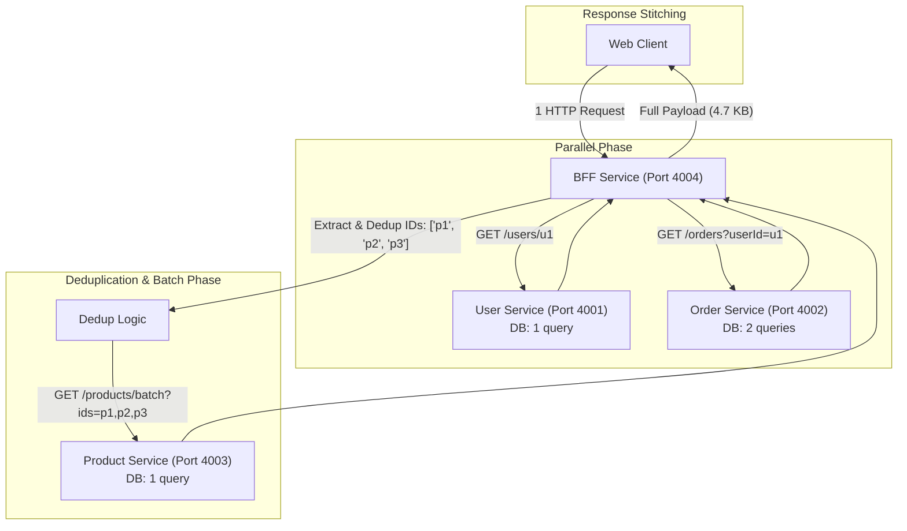
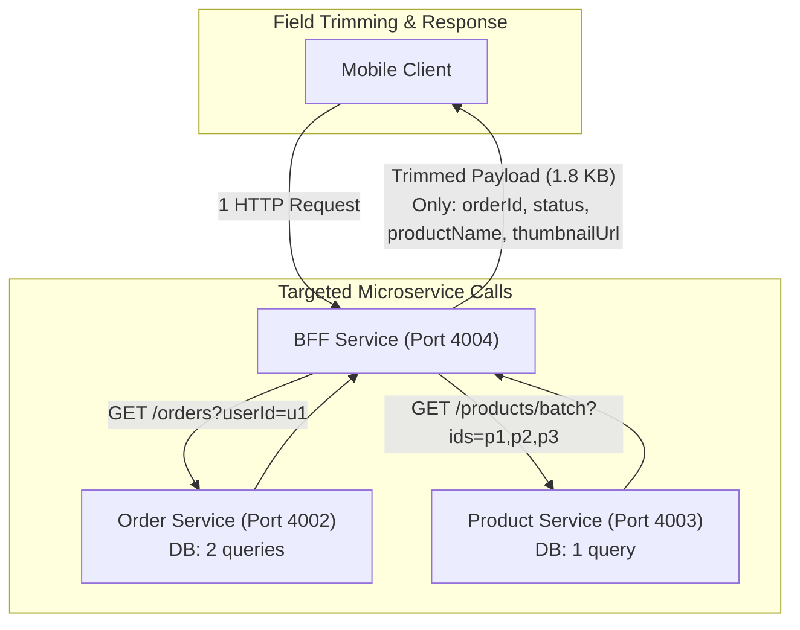

# BẰNG CHỨNG THỰC NGHIỆM & PHÂN TÍCH HỆ THỐNG (EVIDENCE)
**Dự án**: Web nâng cao - Tuần 2 - Block 2: API Composition  
**Nhóm thực hiện**: Nhóm phát triển phần mềm  
**Mục tiêu**: Cung cấp bằng chứng thực tế về Trace N+1, Call Graph nội bộ BFF, Đối chiếu dữ liệu giữa 2 loại client, Kết quả kiểm thử sự cố (Chaos Testing), và Phân tích Trade-off.

---

## 1. Trace N+1 Trước và Sau Khi Sửa (GraphQL)

### 1.1 Trace TRƯỚC khi sửa (GraphQL N+1 Problem)
- **Cơ chế**: Resolver `OrderItem.product` gọi hàm `fetch` riêng lẻ tới Product Service `GET /products/:productId` cho mỗi item trong đơn hàng.
- **Tập dữ liệu**: Large Dataset (User `u2`, 50 đơn hàng, 125 items).
- **Log hệ thống**:
```text
[GraphQL Execution Mode: n1]
├── Call 1: GET http://localhost:4001/users/u2
├── Call 2: GET http://localhost:4002/orders?userId=u2 (Order Service -> 50 orders)
├── Call 3: GET http://localhost:4003/products/p4
├── Call 4: GET http://localhost:4003/products/p7
├── Call 5: GET http://localhost:4003/products/p4  <-- Trùng lặp sản phẩm p4!
├── Call 6: GET http://localhost:4003/products/p10
...
└── Call 127: GET http://localhost:4003/products/p5

Tổng kết Trace N+1:
- Client Requests: 1
- Internal Calls: 127 calls
- Product Service DB Queries: 125 queries riêng lẻ (SELECT * FROM products WHERE id = 'p...')
- Median thời gian hoàn tất response: 201 ms (Cold run: 300 ms)
```

### 1.2 Trace SAU khi sửa (GraphQL với DataLoader - Batching & Deduplication)
- **Cơ chế**: Sử dụng `DataLoader` gom tất cả Product ID được yêu cầu trong 1 event loop tick, loại bỏ trùng lặp chỉ còn 10 ID duy nhất (`p1` đến `p10`), sau đó gửi đúng 1 request batch `GET /products/batch?ids=...`.
- **Log hệ thống**:
```text
[GraphQL Execution Mode: dataloader]
├── Call 1: GET http://localhost:4001/users/u2
├── Call 2: GET http://localhost:4002/orders?userId=u2 (Order Service -> 50 orders)
└── Call 3: GET http://localhost:4003/products/batch?ids=p1,p2,p3,p4,p5,p6,p7,p8,p9,p10
    └── Product Service SQL: SELECT * FROM products WHERE id IN (?, ?, ?, ?, ?, ?, ?, ?, ?, ?)

Tổng kết Trace DataLoader:
- Client Requests: 1
- Internal Calls: 2 calls (nếu chỉ query orders) hoặc 3 calls (nếu kèm user)
- Product Service DB Queries: 1 query duy nhất!
- Median thời gian hoàn tất response: 23 ms (giảm so với chế độ N+1)
```

---

## 2. Call Graph Nội bộ của BFF (BFF Call Graph)

BFF chịu trách nhiệm đóng vai trò Gateway tổng hợp (Aggregator) và điều phối các dịch vụ hạ tầng phía sau:

### 2.1 Call Graph cho Web Dashboard (`GET /api/web/dashboard?userId=u1`)


### 2.2 Call Graph cho Mobile App (`GET /api/mobile/orders?userId=u1`)


---

## 3. Đối Chiếu Dữ Liệu Hai Loại Client (Web vs Mobile)

Cả BFF và GraphQL đều đảm bảo phục vụ đúng nhu cầu cấu trúc dữ liệu của từng đối tượng người dùng:

| Tiêu chí đối chiếu | Web Dashboard Client | Mobile App Client |
| :--- | :--- | :--- |
| **Mục đích** | Màn hình quản lý máy tính cá nhân | Ứng dụng điện thoại thông minh |
| **Thông tin User** | Có (Họ tên, email, điện thoại, địa chỉ, avatar) | Không (Tiết kiệm băng thông) |
| **Thông tin Đơn hàng** | Đầy đủ (Mã đơn, ngày đặt, trạng thái, địa chỉ nhận hàng, phương thức thanh toán, tổng tiền) | Chỉ giữ: Mã đơn (`orderId`) và trạng thái (`status`) |
| **Chi tiết Sản phẩm** | Đầy đủ (ID, tên, đơn giá, số lượng, mô tả, danh mục, thumbnail, tình trạng tồn kho, thành tiền) | Tinh gọn: Tên sản phẩm (`productName`) và ảnh nhỏ (`thumbnailUrl`) |
| **Kích thước Payload (Large)** | **58.6 KB** | **22.6 KB** (BFF) / **20.9 KB** (GraphQL) — **Giảm hơn 61%** |
| **Số Internal Calls (BFF)** | 3 calls (User + Order + Product Batch) | 2 calls (Order + Product Batch, không gọi User) |

---

## 4. Kết Quả Kiểm Thử Sự Cố (Chaos Testing & Error Policy)

Chính sách đã chốt trong `PLAN.md`: **Partial Failure (Trả dữ liệu một phần có cờ đánh dấu lỗi, không dùng giá trị giả)**.

### 4.1 Thử nghiệm 1: Product Service trả về lỗi HTTP 500
- **Thao tác**: Gọi BFF và GraphQL kèm cờ `fault=500`.
- **Kết quả ghi nhận**:
  - Mã HTTP trả về cho Client: **200 OK** (Dịch vụ tổng hợp vẫn hoạt động).
  - Trường `user`: Trả về bình thường (`Alice Nguyen`).
  - Trường `orders`: Trả về 5 đơn hàng bình thường.
  - Trường `product`: Nhận giá trị `null` trong từng order item (Tuân thủ nghiêm ngặt: không bịa tên, không giả giá).
  - Mảng `errors`:
    ```json
    [
      {
        "service": "product-service",
        "status": 500,
        "message": "Không thể tải dữ liệu sản phẩm: Service returned HTTP 500",
        "affectedProductIds": ["p1", "p2", "p3"]
      }
    ]
    ```

### 4.2 Thử nghiệm 2: Product Service bị chậm 2000ms (Vượt quá Timeout 1500ms)
- **Thao tác**: Gọi BFF và GraphQL kèm cờ `delay=2000`.
- **Kết quả ghi nhận**:
- BFF ngắt Product Service sau **1540 ms** nhờ `AbortController(1500ms)`.
- GraphQL hoàn tất sau **1528 ms**, trả `product: null` kèm `errors`.
- Không gây treo hệ thống hay nghẽn tài nguyên vô hạn.
  - Trả về dữ liệu một phần (Partial data) với thông báo:
    `{ "service": "product-service", "status": 408, "message": "Timeout" }`.

---

## 5. Ghi Chú Trade-Off & Giới Hạn của Phép Đo

### 5.1 Đánh giá Trade-Off giữa các Kiến trúc
1. **Baseline**:
   - *Ưu điểm*: Backend cực kỳ đơn giản, không cần dựng thêm tầng ghép nối.
   - *Nhược điểm*: Client quá "nhiều chuyện" (Chatty), phụ thuộc băng thông client, rò rỉ cấu trúc microservice nội bộ ra ngoài internet, hiệu năng tệ khi dữ liệu lớn.
2. **BFF (Backend For Frontend)**:
   - *Ưu điểm*: Tối ưu response theo từng client, logic ghép tập trung, hỗ trợ cắt tỉa payload.
   - *Nhược điểm*: Khi có nhiều loại client mới (IoT, Tablet, Smart TV), đội backend phải viết và bảo trì thêm nhiều endpoint riêng.
3. **GraphQL**:
   - *Ưu điểm*: Rất linh hoạt, client tự khai báo đúng trường mình cần mà không cần backend sửa code; schema được định kiểu mạnh (Strict Typing).
   - *Nhược điểm*: Nguy cơ tiềm ẩn lỗi N+1 nếu không dùng DataLoader; chi phí phân tích cú pháp query (AST parse) và overhead bộ nhớ cao hơn REST thuần túy.

### 5.2 Giới hạn của Phép Đo (Measurement Limitations)
- Phép đo được thực hiện trên môi trường máy cục bộ (`localhost`):
  - Độ trễ mạng (RTT) gần như bằng 0 (< 1ms). Trong môi trường thực tế qua mạng 4G/5G hoặc Internet công cộng với RTT 30-80ms, khoảng cách thời gian giữa Baseline (127 request nối tiếp) và BFF/GraphQL (1 request duy nhất) sẽ còn chênh lệch khủng khiếp hơn (Baseline có thể mất từ 3 đến 8 giây).
- Dữ liệu thử nghiệm sử dụng SQLite đồng bộ; trong môi trường phân tán đa máy chủ (Distributed DB), hiệu ứng N+1 sẽ tác động nặng nề hơn vào băng thông I/O của database.
